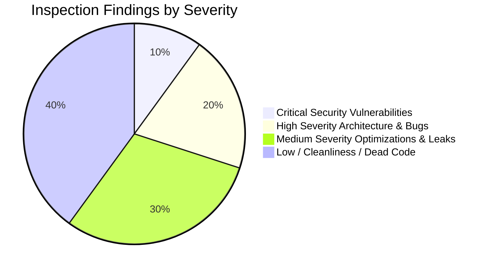
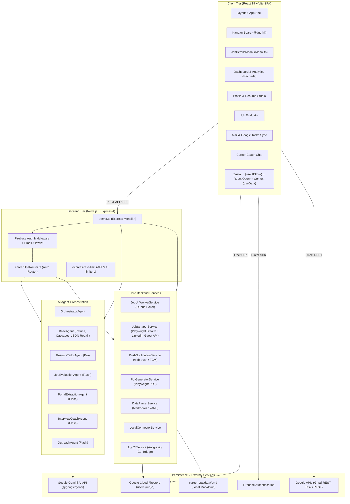
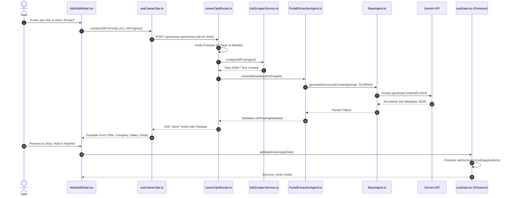
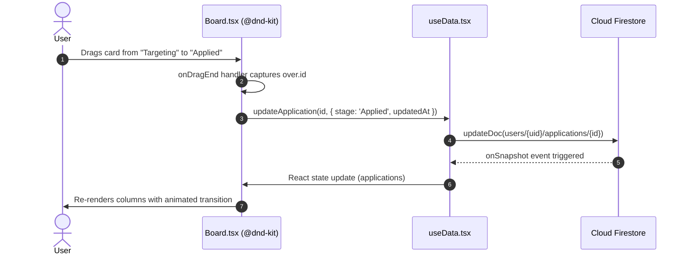
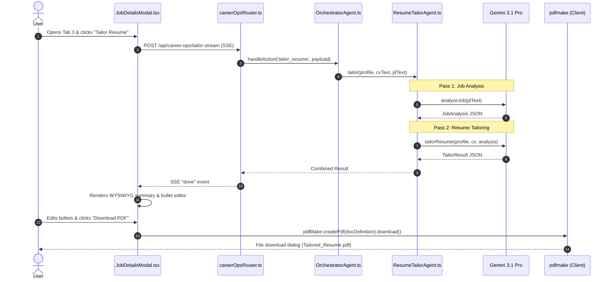
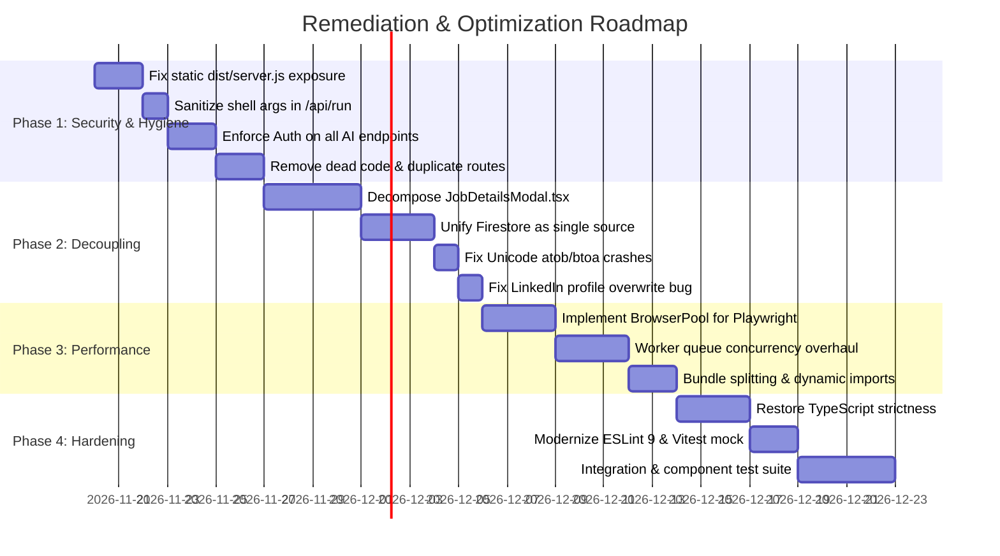

# Career Manager — Software Specification & Architecture Document

> **Status:** Approved / Comprehensive Inspection Complete  
> **Date:** November 19, 2026  
> **Target Application:** `career-manager`  
> **Authors:** Senior Software Development Engineers (7-Subagent Inspection Swarm)  
> **Codebase Size:** ~16,700 lines of TypeScript/TSX (Frontend & Backend)  

---

## 1. Executive Summary

### 1.1 Application Overview
**Career Manager** is a full-stack, AI-orchestrated career management platform designed to automate and streamline the job hunting and application lifecycle. The system provides an end-to-end suite of tools:

1. **Kanban Pipeline Board**: Visual drag-and-drop tracking of job applications through 8 distinct stages (`Targeting`, `Referral Requested`, `Applied`, `Recruiter Screen`, `Technical Loop`, `Onsite`, `Offer Extended`, `Archived`).
2. **Autonomous Job URL Ingestion**: Headless scraping via Playwright and LinkedIn Guest APIs, combined with Gemini AI-based role extraction and background queue polling.
3. **AI Resume Tailoring & PDF Generation**: Two-pass ATS-optimized resume customization based on job descriptions with real-time WYSIWYG editing and PDF generation via `pdfmake` and Playwright.
4. **AI-Powered Outreach & Interview Coaching**: Automated multi-persona outreach message generation (Recruiter, Hiring Manager, Friend) with red-team self-assessment, alongside STAR-framework interview prep synthesis.
5. **Analytics & Performance Tracking**: Real-time funnel conversion metrics, follow-up staleness detection, and stage bottleneck visualization.
6. **Integrations**: Google Workspace synchronization (Gmail message drafting/sending, Google Tasks interview scheduling), Web Push notifications (VAPID / FCM), and local Antigravity CLI integration.

### 1.2 Inspection Summary & Key Findings
A rigorous, multi-agent code inspection was conducted across seven functional slices of the codebase (Server & API, AI Agents, Backend Services, Kanban/Dashboard, Secondary Features, Shared Frontend, and Tests/Build/Security).



#### Top Critical Architectural & Security Discoveries:
1. **Public Exposure of Backend Server & Sourcemaps (`dist/server.js`)**: The build pipeline compiles the backend server into the static frontend output directory (`dist/server.js` and `dist/server.js.map`). Because Express serves `dist/` via `express.static()`, any unauthenticated client can download the entire backend source code and map files.
2. **Unauthenticated AI & Execution Endpoints**: Over 10 AI endpoints in `server.ts` (`/api/gemini/*`) are mounted outside Firebase authentication, allowing anyone to exhaust Gemini API credits or execute arbitrary prompts. Furthermore, `/api/career-ops/run` concatenates unvalidated arguments directly into shell commands via `exec()`, creating a direct shell injection vulnerability.
3. **Monolithic Modal Complexity (`JobDetailsModal.tsx`) (RESOLVED)**: Previously the largest file in the repository at 1,641 lines, embedding 5 independent sub-applications, 25 state hooks, and client-side AI agent instances. This has now been **decomposed into 5 modular sub-components** under `src/features/kanban/components/job-details/` (`JobDescriptionTab`, `JobNotesTab`, `JobResumeTab`, `JobInterviewPrepTab`, `JobOutreachTab`), dropping modal shell size to 314 lines. Client-side `new OutreachAgent()` was completely migrated to the authenticated backend endpoint (`/api/career-ops/draft-outreach`), removing `@google/genai` and Node.js built-in stubs from the browser bundle.
4. **Data Layer Fragmentation & Desynchronization (RESOLVED)**: The Kanban board and Dashboard read/write live **Firestore** (`users/{uid}/applications`). Previously, `PerformanceView` queried a local markdown file on disk (`career-ops/data/applications.md`) via child process execution, causing desynchronization, stale analytics, and `NaN` stage durations. This has now been **retired and unified**: `usePerformanceMetrics` directly consumes live Firestore data via `useData()`, computing funnel survival rates and non-NaN stage durations in real time. In addition, `JobUrlsModal` assigns local IDs (`app-Date.now()`) that fail to match Firestore document IDs, breaking the "View Job" link.
5. **Background Worker Starvation**: `JobUrlWorkerService` processes queue entries across all users sequentially with a hardcoded 65-second sleep between every job, locking the worker for nearly an hour on moderate queues and causing scheduled 2-minute ticks to stall with `Previous cycle still in progress`.
6. **Synthetic Testing & Live Cloud Side-Effects**: The codebase has only 7 tests across 3 files. `ExtractJobUrlWarnings.test.ts` is 100% synthetic (copy-pasting string logic inline rather than testing production code), while `PushNotificationService.test.ts` connects to live Google Cloud Firestore (`career-manager-8037a`) and writes `vapid-keys.json` to the workspace disk during unit test execution.

---

## 2. Architecture & Technology Stack

### 2.1 High-Level Architecture Diagram



### 2.2 Technology Stack Matrix

| Layer | Component / Tool | Version | Purpose / Scope |
| :--- | :--- | :--- | :--- |
| **Frontend Framework** | React | `^19.0.1` | Core UI library |
| **Bundler & Dev Server** | Vite | `^6.2.3` | Client bundling, HMR, production build |
| **Styling** | Tailwind CSS / Vite Plugin | `^4.1.14` | Utility-first CSS engine |
| **State Management** | Zustand | `^5.0.14` | Global UI and layout state (`useUIStore`) |
| **Server State / Cache** | TanStack React Query | `^5.101.4` | Async caching and backend query polling |
| **Drag & Drop** | `@dnd-kit/core`, `@dnd-kit/sortable` | `^6.3.1` / `^10.0.0` | Kanban card drag-and-drop interactions |
| **Visualizations** | Recharts | `^3.10.0` | Funnel, Pipeline Area, and Time-in-Stage charts |
| **Client PDF Export** | `pdfmake` | `^0.3.11` | Client-side ATS resume PDF generation |
| **Client HTML2PDF** | `html2pdf.js` | `^0.14.0` | DOM-to-PDF rendering in ResumeStudio |
| **Backend Runtime** | Node.js + Express | `^4.21.2` | REST API, SSE streaming, static hosting |
| **AI SDK** | `@google/genai` | `^2.4.0` | Official Google GenAI SDK (Gemini 2.5/3.0/3.8) |
| **Database & Auth** | Firebase & Firebase Admin | `^12.16.0` / `^14.4.0` | Cloud Firestore, Firebase Auth, FCM |
| **Web Scraping** | Playwright (`chromium`) | `^1.61.1` | Headless browser execution for job scrapers |
| **Push Notifications** | `web-push` | `^4.0.0` | RFC 8291 / 8292 Web Push VAPID dispatcher |
| **Input Validation** | Zod | `^4.4.3` | Type-safe schema validation on API payloads |
| **Testing** | Vitest | `^4.1.10` | Unit test execution |

---

## 3. Functionality Inventory & Code Traversal

### 3.1 Kanban Application Pipeline Tracker
- **Primary Source Files**: `src/features/kanban/components/Board.tsx`, `Column.tsx`, `KanbanCard.tsx`, `TableView.tsx`, `useKanban.ts`.
- **User Actions**:
  - Drag cards across 8 status columns (`Targeting` → `Referral Requested` → `Applied` → `Recruiter Screen` → `Technical Loop` → `Onsite` → `Offer Extended` → `Archived`).
  - Search applications by company name or role title in real time.
  - Filter by pipeline stage.
  - Switch between visual Kanban lanes and tabular list view (`TableView.tsx`).
  - Schedule interview / follow-up dates via inline `DatePicker` on cards.
  - Quick action buttons to open details directly to "Prep", "Tailor", or "Outreach" tabs.
  - Delete application with Radix UI alert confirmation dialog.
- **Code Traversal**:
  ```
  User drags card -> DndContext onDragEnd (Board.tsx:143)
    -> Computes destination column from over.id
    -> Calls useData().updateApplication(appId, { stage: newStage, updatedAt: ISO })
    -> Firestore updateDoc(doc(db, 'users', uid, 'applications', appId), updates)
    -> onSnapshot fires in useData.tsx:102
    -> State updates applications array
    -> Board re-renders column cards
  ```

### 3.2 Single & Bulk Job Extraction Subsystem
- **Primary Source Files**: `src/features/kanban/components/AddJobModal.tsx`, `src/lib/services/JobScraperService.ts`, `src/lib/api/careerOpsRouter.ts`, `src/agents/PortalExtractionAgent.ts`.
- **User Actions**:
  - **URL Mode**: Paste link to job posting (Greenhouse, Lever, LinkedIn, Ashby, Workday, etc.). Click "Extract with Career Agent". Inspect structured extraction with high/medium/low confidence ratings. Edit fields or remove requirements before saving.
  - **Text Mode**: Paste raw job description text. Save directly to `Targeting` column.
- **Code Traversal**:
  ```
  User pastes URL -> clicks "Extract" (AddJobModal.tsx:75)
    -> Calls useCareerOps().extractJobFromUrl({ url }, onProgress)
    -> POST /api/career-ops/extract-job-url (SSE stream)
    -> careerOpsRouter.ts:580 verifies Firebase ID Token
    -> Scrapes URL via JobScraperService.scrapeJobPosting(url)
       - If LinkedIn: calls guest API https://www.linkedin.com/jobs-guest/jobs/api/jobPosting/<id>
       - Else: launches Playwright Chromium with stealth flags, strips tags, returns text
    -> Checks anti-bot challenge (Cloudflare / Ray ID)
    -> OrchestratorAgent.handleAction('parse_job_page', { domSnippet })
    -> PortalExtractionAgent.extractMetadata() -> BaseAgent.generateStructuredContent()
    -> Returns structured JSON payload via SSE 'done' event
    -> AddJobModal populates form fields
    -> User clicks "Add to Pipeline"
    -> useData().addApplication() creates Firestore doc in users/{uid}/applications
  ```

### 3.3 Autonomous Job URL Ingest Queue & Worker
- **Primary Source Files**: `src/features/kanban/components/JobUrlsModal.tsx`, `src/lib/services/JobUrlWorkerService.ts`, `scripts/traverseJobUrls.ts`.
- **User Actions**:
  - Add individual or bulk job URLs into a pending queue.
  - Filter queue by `all`, `pending`, `completed`, `failed`.
  - View background autonomous worker status (running state, last run, next scheduled run, polling interval).
  - Click "Trigger Server Ingest" to force an immediate backend worker sweep.
  - Click "Traverse All Pending" for client-side progressive traversal.
  - Subscribe to Web Push notifications to receive alerts when background worker finishes imports.
- **Code Traversal**:
  ```
  JobUrlWorkerService.start() (every 120s) OR POST /api/career-ops/job-urls/trigger
    -> runCycle() checks this.isProcessing lock
    -> Queries all users in adminDb.collection('users')
    -> For each user, queries users/{uid}/job_urls where status == 'pending' (limit 5)
    -> For each job URL:
         1. isObviouslyNotAJobUrl() heuristic check
         2. Set status = 'traversing'
         3. JobScraperService.scrapeJobPosting(url)
         4. Anti-bot check -> if blocked, fallback regex inferRoleAndCompanyFromUrl()
         5. AI extraction via AgyCliService or Gemini Flash SDK
         6. Validate isJobPosting == true & single_job_posting
         7. Deduplicate against existing applications where jobUrl == url
         8. Upsert application in users/{uid}/applications (Stage: 'Targeting')
         9. Update job_urls doc: status = 'completed'
         10. await sleep(65000) (polite pacing delay)
    -> Send PushNotificationService.sendDailyImportNotification()
  ```

### 3.4 Job Details, Resume Tailoring, & Interview Prep
- **Primary Source Files**: `src/features/kanban/components/JobDetailsModal.tsx` (1,641 lines), `src/agents/ResumeTailorAgent.ts`, `src/agents/InterviewCoachAgent.ts`, `src/agents/OutreachAgent.ts`.
- **User Actions**:
  - **Tab 1 (JD Viewer)**: Toggle between formatted Markdown and raw text; re-extract metadata via AI.
  - **Tab 2 (Notes)**: View AI executive summary; write and auto-save personal notes.
  - **Tab 3 (Resume Studio)**: Trigger AI resume tailoring; inline edit tailored professional summary; edit and delete bullet points per company role; add new bullets; copy cover letter; download customized ATS-compliant resume PDF.
  - **Tab 4 (Interview Prep)**: Generate AI prep plan; view architecture/system design questions with tagged focus areas; view behavioral prompts with evaluation criteria.
  - **Tab 5 (Outreach Drafts)**: Select audience (`Recruiter`, `Hiring Manager`, `Friend`) and tone (`Professional`, `Casual`, `Direct`); generate AI cold outreach; copy draft with subject lines; browse previous draft versions.
- **Code Traversal**:
  ```
  User clicks "Tailor Resume" -> handleTailorResume() (JobDetailsModal.tsx:482)
    -> POST /api/career-ops/tailor-stream (SSE stream)
    -> careerOpsRouter.ts:655 -> OrchestratorAgent.handleAction('tailor_resume')
    -> ResumeTailorAgent.tailor(profile, cvText, jdText):
         - Pass 1: analyzeJob(jdText) -> JobAnalysis JSON
         - Pass 2: tailorResume(profile, cvText, jdText, analysis) -> TailorResult JSON
    -> Emits SSE progress (20% -> 60% -> 95% -> 100%)
    -> Returns { tailoredSummary, tailoredRoles, coverLetter }
    -> Updates application in Firestore with tailoredContent
    -> Renders WYSIWYG bullet editor
    -> User clicks "Export PDF" -> inline pdfmake creates binary blob -> triggers browser download
  ```

### 3.5 Dashboard & Performance Analytics Subsystem
- **Primary Source Files**: `src/features/dashboard/components/DashboardView.tsx`, `MetricsCards.tsx`, `FunnelChart.tsx`, `PerformanceView.tsx`, `TimeInStageChart.tsx`, `usePerformanceMetrics.ts`, `useSmartFollowUp.ts`.
- **User Actions**:
  - View executive metric totals (Active applications, In Interviews, Offers, Profile Views).
  - Review smart follow-up nudges (alerts for applications stuck in stage: Applied > 7 days, Screen > 4 days, Loop > 5 days, Offer > 2 days).
  - Inspect weekly activity pipeline (applications submitted vs. interviews scheduled day-by-day).
  - View recent application stage transition activity feed.
  - Inspect conversion funnel attrition rates and identify bottleneck stages exceeding 14 days.

### 3.6 Multi-Agent AI System
- **Primary Source Files**: `src/agents/BaseAgent.ts`, `OrchestratorAgent.ts`, `ResumeTailorAgent.ts`, `JobEvaluationAgent.ts`, `PortalExtractionAgent.ts`, `InterviewCoachAgent.ts`, `OutreachAgent.ts`.
- **Agent Matrix**:

| Agent | Target Model | Responsibilities & Capabilities |
| :--- | :--- | :--- |
| **`BaseAgent`** | Abstract | Core LLM harness: JSON parsing & markdown stripping, model fallback cascades (Pro → Flash → Lite), API key rotation, exponential backoff, JSON salvage repairs, emergency Antigravity CLI failover. |
| **`OrchestratorAgent`** | N/A | Central typed dispatcher; routes actions (`evaluate_job`, `tailor_resume`, `parse_job_page`, `batch_evaluate_jobs`, `interview_prep_plan`, `interview_prep_mock`, `interview_prep_debrief`, `draft_outreach`) with validation. |
| **`ResumeTailorAgent`** | `gemini-3.1-pro-preview` | Two-pass resume customization. Strict anti-slop rules, banned phrases, structural voice matching, fact integrity enforcement. |
| **`JobEvaluationAgent`** | `gemini-3.8-flash` | Four-factor weighted evaluation (Skills 40%, Growth 25%, Culture 20%, Comp 15%). Dealbreaker detection, evidence-backed scores (1-100). |
| **`PortalExtractionAgent`** | `gemini-3.8-flash` | Extracts structured schema from noisy web page DOMs. Identifies multi-role directory pages vs. single job postings. Confidence ratings per field. |
| **`InterviewCoachAgent`** | `gemini-3.8-flash` | Generates targeted prep plans, STAR behavioral prompts, system design deep-dives, mock interview Q&A with evaluation scores, and post-interview debriefs. |
| **`OutreachAgent`** | `gemini-3.8-flash` | Multi-channel outreach generator (LinkedIn note, DM, cold email). Includes recipient perspective red-team critique and tone control. |

### 3.7 Profile Management & LinkedIn Import
- **Primary Source Files**: `src/features/profile/components/ProfileView.tsx`, `EditProfileModal.tsx`, `ImportLinkedInModal.tsx`, `src/services/linkedinImportService.ts`.
- **User Actions**:
  - Manage candidate master profile: Headline, Summary, Target Roles, Minimum Compensation, Skills, Career History, Education, Certifications, Contact Info.
  - Multi-profile support: Switch between active profiles (e.g. "Full-Stack Engineer" vs "Engineering Manager").
  - Import profile data from LinkedIn profile export JSON.
  - Download/Export profile data.

### 3.8 Resume Studio
- **Primary Source Files**: `src/features/resume-studio/components/ResumeStudio.tsx`, `src/lib/services/PdfGeneratorService.ts`.
- **User Actions**:
  - Live side-by-side resume editor and preview.
  - Select between styling templates (Modern, Classic, Minimalist, Technical).
  - Customize margins, font scale, accent color, and section ordering.
  - Export resume to PDF directly via `html2pdf.js` in the browser or via backend Playwright Chromium (`/api/career-ops/generate-pdf`).

### 3.9 Standalone Job Evaluator
- **Primary Source Files**: `src/features/evaluate/components/EvaluateView.tsx`, `src/agents/JobEvaluationAgent.ts`.
- **User Actions**:
  - Paste any job URL or raw JD text to perform a deep candidate fit analysis.
  - Real-time progress animation with step-by-step evaluation status.
  - Visual display of Match Score (0-100%), Dealbreakers, Pros, Cons, and Key Focus Areas.
  - Search history sidebar: Browse past evaluations stored in Firestore (`users/{uid}/jobsearchhistory`).
  - One-click "+ Add to Target List" to convert an evaluated job into a Kanban application.

### 3.10 Mail & Google Tasks Integration
- **Primary Source Files**: `src/features/mail/components/Inbox.tsx`, `src/features/tasks/components/TasksView.tsx`, `src/hooks/useGmail.ts`, `src/hooks/useTasks.ts`, `src/services/TaskPollingService.ts`.
- **User Actions**:
  - Connect Google Account via OAuth (`gmail.send`, `tasks` scopes).
  - **Inbox**: View incoming recruiter threads; compose and send emails directly from the app; use AI to summarize long recruiter email threads.
  - **Tasks**: Create and complete job search tasks; sync interview milestones directly to Google Tasks.
  - Automatic stage advancement: Completed interview tasks auto-advance application pipeline stage.

### 3.11 Career Coach Chat
- **Primary Source Files**: `src/components/chat/CareerCoach.tsx`, `server.ts` (`/api/gemini/career-coach`).
- **User Actions**:
  - Floating slide-over AI coach conversational drawer accessible from any screen.
  - Contextual awareness: AI possesses full candidate profile and current application pipeline state.
  - Auto-summarization of conversation history every 10 messages to preserve LLM context window.

### 3.12 Push Notifications Subsystem
- **Primary Source Files**: `src/lib/services/PushNotificationService.ts`, `PushNotificationClient.ts`, `public/sw.js`.
- **User Actions & System Architecture**:
  - Web Push RFC 8291 / 8292 implementation using VAPID key pairs.
  - Automatic VAPID key generation and disk persistence (`vapid-keys.json`).
  - Browser Service Worker (`sw.js`) intercepts push events and shows system desktop notifications.
  - Backend automated trigger sends daily summary alerts when background URL crawler completes ingesting new jobs.

---

## 4. End-to-End Code Flow Traces

### Trace 1: Adding a Job via URL Extraction


### Trace 2: Dragging a Card Between Kanban Pipeline Stages


### Trace 3: AI Resume Tailoring & PDF Export


---

## 5. Dead, Obsolete, & Redundant Code Catalog

### 5.1 100% Dead Files (Never Imported or Executed)

| File Path | Lines | Reason for Deletion |
| :--- | :--- | :--- |
| `src/features/kanban/api/updateApplication.ts` | 19 | Attempts to call `/api/career-ops/tracker/update`. Completely unreferenced across the codebase; all components use Firestore `useData().updateApplication`. |
| `src/components/ui/avatar.tsx` | 107 | Radix UI Avatar primitive. 0 imports across the entire repository. |
| `src/components/ui/dropdown-menu.tsx` | 257 | Radix UI Dropdown primitive. 0 imports across the entire repository. |
| `src/components/ui/scroll-area.tsx` | 56 | Radix UI ScrollArea primitive. 0 imports across the entire repository. |

### 5.2 Duplicate & Redundant Routes

| Route | `server.ts` Location | `careerOpsRouter.ts` Location | Status & Recommendation |
| :--- | :--- | :--- | :--- |
| `/draft-outreach` | L240–286 (Unauthenticated) | L724–765 (Authenticated) | **DELETE from `server.ts`**. Identical logic; router version is authenticated and has Zod validation. |
| `/prep-interview` | L318–391 (Unauthenticated) | L777–839 (Authenticated) | **DELETE from `server.ts`**. Identical logic; router version is authenticated and has Zod validation. |
| `/notifications/vapid-key` | L187–197 (Unauthenticated) | L848–855 (Authenticated) | **DEDUPLICATE**. Both files mount this endpoint, causing route collision. |
| `/job-urls/*` | L151–181 (Mounted twice) | N/A | **CLEAN UP**. Mounted under both `/api/job-urls/*` and `/api/career-ops/job-urls/*`. |

### 5.3 Dead Imports & Orphaned Variables

| File | Line | Identifier | Issue |
| :--- | :--- | :--- | :--- |
| `server.ts` | L1 | `execFile` from `child_process` | Imported but never used; only `exec` is used. |
| `server.ts` | L2 | `promisify` from `util` | Imported with comment "removed local promisify"; dead import. |
| `careerOpsRouter.ts` | L8 | `COMMANDS as tracker` | Imported from `tracker.mjs` but never used. |
| `careerOpsRouter.ts` | L9, L52 | `DataParserService` / `dataParser` | Instantiated in router setup but 0 references in route handlers. |
| `src/agents/BaseAgent.ts` | L3 | `callGeminiApi` | Imported in BaseAgent but BaseAgent instantiates `GoogleGenAI` directly. |
| `scripts/seedJobUrls.ts` | L1 | `adminAuth` | Imported from `firebaseAdmin` but only `adminDb` is used. |
| `src/components/layout/Layout.tsx` | L18, L38 | `Activity`, `setUserProfile` | Unused Lucide icon import and write-only React state variable. |

---

## 6. Code Quality, Security, & Optimization Analysis

### 6.1 Critical Security Vulnerabilities

#### 1. Public Exposure of Backend Server & Sourcemaps (`dist/server.js`)
- **Severity**: 🚨 **CRITICAL**
- **Files**: `package.json` (build script), `server.ts` (L641–645).
- **Vulnerability**: `npm run build` compiles `server.ts` into `dist/server.js` and `dist/server.js.map`. In `server.ts`, Express statically serves `dist/` via `app.use(express.static(path.join(__dirname, 'dist')))`. Any user or automated bot can make a `GET /server.js` or `GET /server.js.map` request and download the full, unminified backend source code, route structures, and internal environment key identifiers.
- **Remediation**: Separate the server build output into `dist-server/` or `build/`, and configure `express.static` to only serve the client directory (`dist/client/` or `dist/`).

#### 2. Shell Injection in `/api/career-ops/run`
- **Severity**: 🚨 **CRITICAL**
- **File**: `server.ts` (L614–631).
- **Vulnerability**: 
  ```typescript
  const command = `cd src/career-ops && npm run ${script} -- ${args || ''}`;
  exec(command, ...);
  ```
  While `script` is validated against an allowlist, the `args` parameter is concatenated directly into the shell string without sanitization. An attacker can send `{ "script": "doctor", "args": "; rm -rf /" }` or invoke reverse shells.
- **Remediation**: Replace `exec()` with `execFile('npm', ['run', script, '--', ...sanitizedArgs])` which does not spawn an OS shell, or enforce strict alphanumeric regex validation on `args`.

#### 3. Unauthenticated AI & CLI Proxy Endpoints
- **Severity**: 🚨 **CRITICAL**
- **File**: `server.ts` (L207–600).
- **Vulnerability**: Over 10 endpoints (including `/api/gemini/tailor-resume`, `/api/gemini/agy-proxy`, `/api/gemini/career-coach`, `/api/gemini/career-ops`, `/api/career-ops/scrape-job`) are mounted before `careerOpsRouter` and have **no authentication middleware**. Anyone on the internet can call these endpoints to consume Gemini API quota or invoke the local Antigravity CLI binary via `/api/gemini/agy-proxy`.
- **Remediation**: Apply Firebase ID token authentication middleware to all `/api/gemini/*` and `/api/career-ops/*` routes.

#### 4. Plaintext Secrets & PII Logging
- **Severity**: 🔴 **HIGH**
- **Files**: `src/lib/utils/geminiClient.ts` (L83–92, L117–121), `vapid-keys.json`, `.env.example`.
- **Vulnerability**:
  - `geminiClient.ts` unconditionally logs the entire prompt and full response of every Gemini call to stdout. This leaks candidate CVs, addresses, phone numbers, and recruiter notes into server log files.
  - `vapid-keys.json` containing live VAPID private keys is committed to the repository.
  - Personal developer email addresses and dedicated ngrok URLs are committed in config files.
- **Remediation**: Gate verbose logging behind `process.env.NODE_ENV !== 'production'`. Add `vapid-keys.json` to `.gitignore` and load private keys strictly from environment variables.

#### 5. Google OAuth Token Storage & Silent 1-Hour Expiration
- **Severity**: 🔴 **HIGH**
- **Files**: `src/store/firebase.ts` (L38–41), `useGmail.ts`, `useTasks.ts`.
- **Vulnerability**: Third-party Google OAuth access tokens are stored in browser `localStorage`. While Firebase ID tokens auto-refresh, Google OAuth access tokens expire in exactly 3600 seconds (1 hour). Returning users experience silent 401 Unauthorized API failures in Gmail and Tasks with no automatic token refresh mechanism.
- **Remediation**: Implement a token refresh flow using Google OAuth refresh tokens via a secure backend endpoint, or detect 401s and trigger re-authentication.

### 6.2 Architectural Fragmentation & Concurrency Bottlenecks

#### 1. Monolithic Complexity in `JobDetailsModal.tsx` (RESOLVED)
- **Problem**: Previously represented 10% of the entire codebase in a single component (1,641 lines). Combined JD viewer, Notes editor, Resume Tailor with WYSIWYG bullet editing, PDFMake client binary generation, Interview Prep, and Outreach drafting. 25 state hooks caused re-rendering of the entire tree on any progress tick. In addition, `new OutreachAgent()` was instantiated in the client, pulling Node.js dependencies into the Vite bundle.
- **Resolution**: Fully decomposed into a lean 314-line modal shell and 5 focused, independently rendered sub-components in `src/features/kanban/components/job-details/`:
  - `JobDescriptionTab.tsx` (426 lines) — Formatted Markdown & raw JD viewer, AI re-extraction, copy controls.
  - `JobNotesTab.tsx` (62 lines) — Application notes with automatic Firestore persistence on blur.
  - `JobResumeTab.tsx` (491 lines) — Tailored summary & experience bullet WYSIWYG editor, cover letter, and dynamic `pdfmake` ATS PDF export.
  - `JobInterviewPrepTab.tsx` (160 lines) — System design architecture questions & behavioral STAR prompt cards.
  - `JobOutreachTab.tsx` (287 lines) — Persona and tone networking message generator with draft history.
  - `draftOutreach.ts` (API client) — Migrated client outreach to authenticated backend route `/api/career-ops/draft-outreach`, eliminating all client-side `@google/genai` and agent imports.

#### 2. Global Worker Starvation in `JobUrlWorkerService.ts`
- **Problem**: Lines 355–357 and 403–410 iterate through all users sequentially and enforce a hardcoded 65-second sleep (`delayBetweenJobsMs = 65000`) after each job. If 10 users each have 5 pending URLs, the worker run takes `10 × 5 × 65s = 3,250s` (~54 minutes). Because the worker acquires an `isProcessing` mutex lock, all subsequent 2-minute interval ticks fail with `Previous cycle still in progress`.
- **Remediation**: Decouple queue processing per user. Use job concurrency pools with token-bucket rate limiting for Gemini rather than synchronous serial sleeps.

#### 3. Data Source Split: Live Firestore vs. Local Markdown (RESOLVED)
- **Problem**: `Board.tsx` and `DashboardView.tsx` read from Firestore. `PerformanceView.tsx` previously called `getApplications()` (`careerOpsRouter.ts`), which shelled out to `tracker.mjs` to read from local markdown on disk. The two data sources diverged immediately. Furthermore, because local markdown lacked `updatedAt` timestamps, `usePerformanceMetrics` calculated `NaN` for time-in-stage metrics.
- **Resolution**: Retired `getApplications.ts` and refactored `usePerformanceMetrics` to directly consume `useData().applications` (Cloud Firestore). All metrics (funnel conversion rates, total pipeline count, and bottleneck stage durations) now update instantly via Firestore `onSnapshot` listeners with safe timestamp fallbacks that eliminate `NaN` durations.

### 6.3 Performance & Bundle Bloat

#### 1. Client Bundle Bloat (>5.7 MB uncompressed)
- **Problem**: Vite produces an oversized initial bundle (`index.js` at 1.14 MB). `pdfmake` + `vfs_fonts` (1.86 MB) and `html2pdf.js` (1.0 MB) are imported statically rather than dynamically loaded. Additionally, a 989 KB uncompressed `app-icon.png` is bundled and loaded in `Layout.tsx` for a 32px sidebar icon.
- **Remediation**:
  - Convert `pdfmake` and `html2pdf.js` to dynamic imports (`await import(...)`) triggered only when the user clicks "Download PDF".
  - Configure `manualChunks` in `vite.config.ts` to split vendor libraries (`react`, `@google/genai`, `@dnd-kit`, `recharts`).
  - Optimize `app-icon.png` to SVG or compressed WebP (<20 KB).

#### 2. Ephemeral Chromium Process Thrashing
- **Problem**: `JobScraperService.ts`, `PdfGeneratorService.ts`, and `LocalConnectorService.ts` launch a full OS-level Chromium browser process (`chromium.launch()`) and close it (`browser.close()`) on every single scrape or PDF operation. Spawning multiple browser processes simultaneously causes severe CPU spikes and server OOM crashes.
- **Remediation**: Implement a singleton `BrowserPool` that keeps a single headless browser instance alive and spawns isolated lightweight `BrowserContext` instances per request.

#### 3. Monolithic React Context Re-render Cascade
- **Problem**: `DataProvider` in `useData.tsx` passes a single non-memoized context value containing 5 live Firestore collections and 12 mutation callbacks. Any single Firestore snapshot update (e.g., a background URL worker tick) re-renders the entire application tree (`Layout`, sidebar, and all child views).
- **Remediation**: Memoize the context value with `useMemo`, or split into separate `DataContext` (read-only collections) and `DataActionsContext` (stable mutation callbacks).

### 6.4 Reliability & Edge Cases

#### 1. Unicode DOMException Crashes in Email & Mail
- **Problem**: `Inbox.tsx` (L145, L148) and `useGmail.ts` (L74) use native `atob()` and `btoa()` to encode and decode email bodies. Any email containing emojis, smart quotes, em-dashes, or non-ASCII characters triggers an unhandled `DOMException: InvalidCharacterError`, crashing the mail client.
- **Remediation**: Replace `btoa(str)` with UTF-8 safe base64url encoding:
  ```typescript
  const base64UrlEncode = (str: string) =>
    btoa(encodeURIComponent(str).replace(/%([0-9A-F]{2})/g, (_, p1) => String.fromCharCode(parseInt(p1, 16))))
      .replace(/\+/g, '-').replace(/\//g, '_').replace(/=+$/, '');
  ```

#### 2. Push Subscription ID Collisions in Firestore
- **Problem**: In `PushNotificationService.ts` (L124, L135), subscription document IDs are derived as:
  ```typescript
  const docId = Buffer.from(endpoint).toString('base64url').slice(0, 64);
  ```
  Because all Google FCM push endpoints share the exact same 45-character prefix (`https://fcm.googleapis.com/fcm/send/...`), slicing only the first 64 characters chops off the unique client token suffix. As a result, different client devices belonging to the same user collide and overwrite each other's push subscriptions.
- **Remediation**: Hash the endpoint with SHA-256: `crypto.createHash('sha256').update(endpoint).digest('hex')`.

#### 3. Root Profile Overwrite Bug via LinkedIn Import
- **Problem**: In `ImportLinkedInModal.tsx` (L27–29) and `linkedinImportService.ts` (L108), the import function hardcodes writes to `doc(db, 'users', user.uid)`. If a user is currently editing an alternate persona profile (`activeProfileId = 'profile-2'`), importing LinkedIn data unintentionally overwrites their primary root profile.
- **Remediation**: Pass `activeProfileId` to `importLinkedInDataToFirestore` and target the appropriate profile document.

#### 4. Infinite Re-render Hazard in Career Coach Chat
- **Problem**: In `CareerCoach.tsx` (L39–61), an auto-summarization `useEffect` depends on `[messages, profile.chatSummary, updateProfile]`. Calling `updateProfile` modifies `profile.chatSummary`, which triggers a Firestore snapshot update, which updates the `profile` prop, which re-fires the `useEffect` while `messages.length % 10 === 0` remains true.
- **Remediation**: Track the last summarized message index in a `useRef` to prevent re-triggering.

---

## 7. Proposed Cleanup & Optimization Plan



### Phase 1: Critical Security, Reliability, & Hygiene Fixes (COMPLETED ✅)
1. **Fix Static Server Build Exposure** [RESOLVED]: Updated `package.json`, `Dockerfile`, and `.gitignore` to output server artifacts to `dist-server/server.js`. `dist/` now exclusively holds static client SPA assets, completely preventing unauthenticated downloads of the compiled backend bundle.
2. **Eliminate Shell Injection** [RESOLVED]: In `server.ts` (`/api/career-ops/run`), removed `child_process.exec()` string concatenation. Implemented strict argument whitelist validation (`/^[a-zA-Z0-9_\-\.\/=]+$/`) and switched execution to `execFile('npm', ['run', script, ...])` isolated within the `career-ops/` directory.
3. **Authenticate AI Endpoints** [RESOLVED]: Created shared Express authentication middleware `src/lib/middleware/auth.ts` enforcing Firebase ID token verification and `ALLOWED_EMAILS` validation. Applied across all `/api/gemini/*` endpoints, background job worker routes, and career operations endpoints. Enhanced frontend `apiFetch` in `src/config/api.ts` to seamlessly attach Bearer tokens.
4. **Delete Dead Code & Files** [RESOLVED]:
   - Deleted obsolete `src/features/kanban/api/updateApplication.ts`.
   - Deleted unused UI primitives (`src/components/ui/avatar.tsx`, `dropdown-menu.tsx`, `scroll-area.tsx`).
   - Cleaned dead imports (`callGeminiApi` in `BaseAgent.ts`, `adminAuth` in `scripts/seedJobUrls.ts`, `Activity` & unused profile state in `Layout.tsx`, `tracker` & `dataParser` in `careerOpsRouter.ts`).
5. **Fix Push Subscription Endpoint Collision** [RESOLVED]: Updated `PushNotificationService.ts` to derive subscription and FCM document IDs via SHA-256 hex digest (`crypto.createHash('sha256').update(...).digest('hex')`) instead of 64-character slice truncation.
6. **Fix Path Traversal** [RESOLVED]: Added `resolveSafePath` inside `DataParserService.ts` strictly containing all file reads/writes within `this.baseDir`. Added test suite `src/lib/tests/DataParserService.test.ts`.
7. **Fix AgyCliService & Gemini Config** [RESOLVED]: Removed hardcoded `/home/naval/.local/bin/agy` candidate path, added runtime detection in `isAvailable()`, and deduplicated `'gemini-3.8-flash'` in `GEMINI_FALLBACK_CASCADES`.
8. **Redact Verbose PII Logging** [RESOLVED]: In `geminiClient.ts` and `server.ts`, gated full prompt dumps, resume texts, and raw responses behind `DEBUG === 'true'`, logging only payload sizes in normal operation.

### Phase 2: Architectural Decoupling & Component Decomposition (In Progress)
1. **Deconstruct `JobDetailsModal.tsx`** [RESOLVED]: Decomposed the 1,641-line monolith into 5 modular sub-components in `src/features/kanban/components/job-details/` (`JobDescriptionTab`, `JobNotesTab`, `JobResumeTab`, `JobInterviewPrepTab`, `JobOutreachTab`), reducing `JobDetailsModal.tsx` to 314 lines.
2. **Move `OutreachAgent` to Backend** [RESOLVED]: Removed client-side `OutreachAgent` instantiation from the browser. Client now calls the authenticated backend route `/api/career-ops/draft-outreach`, eliminating browser-external shims for Node.js modules.
3. **Unify Data Sources** [RESOLVED]: Rewrote `PerformanceView.tsx` and `usePerformanceMetrics.ts` to compute funnel metrics and stage durations directly from live Cloud Firestore data via `useData()`, completely retiring local markdown tracker sync and deleting `getApplications.ts`.
4. **Fix Unicode Email Crashes**: Implement UTF-8 safe base64url encoding/decoding in `useGmail.ts` and `Inbox.tsx`.
5. **Fix Profile Overwrite Bug**: Update `linkedinImportService.ts` to accept `targetProfileId` and update the active profile rather than defaulting to root.
6. **Fix JobUrlsModal "View Job" Bug**: In `JobUrlsModal.tsx`, assign application IDs from Firestore's returned document ID instead of ephemeral `app-Date.now()`.

### Phase 3: Performance, Bundle Optimization, & Worker Scalability (Medium Priority)
1. **Headless Browser Pooling**: Replace per-request `chromium.launch()` with a shared `BrowserPool` across `JobScraperService` and `PdfGeneratorService`.
2. **Worker Queue Concurrency Overhaul**: Refactor `JobUrlWorkerService` to process user queues in parallel using a concurrency limiter (`p-limit`) and replace the synchronous 65-second sleep with a token-bucket rate limiter.
3. **Client Bundle Splitting**:
   - Dynamically import `pdfmake` and `html2pdf.js` in `JobDetailsModal` and `ResumeStudio`.
   - Configure `manualChunks` in `vite.config.ts`.
   - Compress `public/app-icon.png` from 989 KB to <20 KB.
4. **Memoize Context Providers**: Split `DataProvider` into data and actions contexts to eliminate re-render cascades across the app.

### Phase 4: Production Hardening, Testing, & Tooling Modernization (Long Term)
1. **Restore TypeScript Strictness**: Fix the 94 recorded type errors in `tsc_errors.log` and re-enable `strict: true`, `noImplicitAny: true`, and `noUnusedLocals: true` in `tsconfig.json`.
2. **Modernize Tooling**: Upgrade ESLint config to ESLint 9 flat config (`eslint.config.js`), fixing the currently broken linter.
3. **Build Comprehensive Test Suite**:
   - Replace synthetic test in `ExtractJobUrlWarnings.test.ts` with tests against exported production utilities.
   - Mock `firebaseAdmin` and `web-push` in `PushNotificationService.test.ts` to eliminate live GCP mutations.
   - Add unit tests for `BaseAgent` model fallback cascades, JSON repairs, and prompt truncation.
   - Install `@testing-library/react` and add component tests for Kanban board drag-and-drop and modal workflows.

---

## 8. Dependency Audit & Package Matrix

### 8.1 Vulnerability Summary (`npm audit`)
- **Total Vulnerabilities**: 27 (1 Critical, 13 High, 11 Moderate, 2 Low).
- **Critical Vulnerability**: `proxy-addr` (denial of service / IP spoofing risk).
- **High Severity Vulnerabilities**: `body-parser` (DoS via URL-encoded payloads), `js-yaml` (prototype pollution / code execution in untrusted parsing), `nanoid` (predictable entropy), `react-router` (XSS via route parameters), `zod` (ReDoS in regex validation).
- **Recommendation**: Run `npm audit fix` and upgrade `zod` to latest v3.x or v4 stable, update `express` to `^4.21.2+`, and migrate to modern router versions.

### 8.2 Dependency Hygiene

| Dependency | Declared Location | Status | Finding & Action |
| :--- | :--- | :--- | :--- |
| `vite` | Both `dependencies` & `devDependencies` | **DUPLICATE** | Remove from `dependencies`; keep only in `devDependencies`. |
| `@google/generative-ai` | `dependencies` (`^0.24.1`) | **REDUNDANT** | Root code uses `@google/genai` (`^2.4.0`). Remove legacy SDK. |
| `html2pdf.js` | `dependencies` (`^0.14.0`) | **HEAVY ASSET** | Statically bundles 1.0 MB into `ResumeStudio`. Convert to dynamic import. |
| `pdfmake` | `dependencies` (`^0.3.11`) | **HEAVY ASSET** | Bundles 1.86 MB into client bundle. Convert to dynamic import. |
| `playwright` | `dependencies` (`^1.61.1`) | **BACKEND ONLY** | Leaks into client bundle warnings when imported indirectly via agents. |

---

## 9. Appendix: Master File Index & Metric Summary

| File Path | Lines | Subsystem | Responsibility |
| :--- | :--- | :--- | :--- |
| `server.ts` | 678 | Backend | Express HTTP server, API endpoints, static hosting |
| `src/lib/api/careerOpsRouter.ts` | 940 | Backend | Authenticated API router for AI streaming & tracking |
| `src/lib/services/JobUrlWorkerService.ts` | 988 | Backend Service | Background job scraping & ingestion worker daemon |
| `src/lib/services/JobScraperService.ts` | 181 | Backend Service | Playwright & LinkedIn Guest API scraper |
| `src/lib/services/PushNotificationService.ts` | 326 | Backend Service | Web Push VAPID & FCM notification manager |
| `src/lib/services/PushNotificationClient.ts` | 176 | Frontend Service | Browser Service Worker push notification client |
| `src/lib/services/PdfGeneratorService.ts` | 97 | Backend Service | Headless Playwright HTML-to-PDF generator |
| `src/lib/services/LocalConnectorService.ts` | 141 | Backend Service | Automated local job search executor |
| `src/lib/services/AgyCliService.ts` | 109 | Integration | Antigravity CLI proxy bridge |
| `src/lib/services/DataParserService.ts` | 68 | Utility | Markdown & YAML file parser |
| `src/services/linkedinImportService.ts` | 113 | Service | LinkedIn JSON export parser & Firestore importer |
| `src/services/TaskPollingService.ts` | 85 | Service | Google Tasks REST polling service |
| `src/agents/BaseAgent.ts` | 234 | AI Layer | Abstract base class for structured LLM generation |
| `src/agents/OrchestratorAgent.ts` | 294 | AI Layer | Central action router and dispatcher |
| `src/agents/ResumeTailorAgent.ts` | 366 | AI Layer | Two-pass resume tailoring & bullet synthesizer |
| `src/agents/OutreachAgent.ts` | 362 | AI Layer | Multi-persona outreach generator with red-team critique |
| `src/agents/InterviewCoachAgent.ts` | 324 | AI Layer | STAR interview prep, mock Q&A, and debrief |
| `src/agents/JobEvaluationAgent.ts` | 180 | AI Layer | Weighted 4-factor candidate-job fit evaluator |
| `src/agents/PortalExtractionAgent.ts` | 173 | AI Layer | Structured job metadata DOM extractor |
| `src/features/kanban/components/JobDetailsModal.tsx` | 314 | Frontend Feature | Decomposed modal shell: header, tabs coordinator, quick info |
| `src/features/kanban/components/job-details/JobDescriptionTab.tsx` | 426 | Frontend Feature | Markdown/Raw JD viewer, copy, AI re-extraction |
| `src/features/kanban/components/job-details/JobNotesTab.tsx` | 62 | Frontend Feature | Application notes with auto-save to Firestore |
| `src/features/kanban/components/job-details/JobResumeTab.tsx` | 491 | Frontend Feature | WYSIWYG summary & bullets editor, PDFMake export |
| `src/features/kanban/components/job-details/JobInterviewPrepTab.tsx` | 160 | Frontend Feature | System design & behavioral interview prep cards |
| `src/features/kanban/components/job-details/JobOutreachTab.tsx` | 287 | Frontend Feature | Multi-persona outreach generator & history |
| `src/features/kanban/api/draftOutreach.ts` | 55 | API Client | Authenticated backend outreach drafting client |
| `src/features/kanban/components/AddJobModal.tsx` | 939 | Frontend Feature | URL extraction & manual job creation modal |
| `src/features/kanban/components/JobUrlsModal.tsx` | 923 | Frontend Feature | Job URLs queue, worker status, push settings |
| `src/features/kanban/components/Board.tsx` | 258 | Frontend Feature | Kanban board container & drag-and-drop coordinator |
| `src/features/kanban/components/KanbanCard.tsx` | 258 | Frontend Feature | Application card with dates and quick actions |
| `src/features/kanban/components/Column.tsx` | 67 | Frontend Feature | Pipeline stage column lane |
| `src/features/kanban/components/TableView.tsx` | 54 | Frontend Feature | Tabular view of applications |
| `src/features/profile/components/EditProfileModal.tsx` | 729 | Frontend Feature | Full candidate profile editor modal |
| `src/features/profile/components/ProfileView.tsx` | 329 | Frontend Feature | Candidate profile overview & skills dashboard |
| `src/features/profile/components/ImportLinkedInModal.tsx` | 158 | Frontend Feature | LinkedIn JSON data import modal |
| `src/features/evaluate/components/EvaluateView.tsx` | 642 | Frontend Feature | Deep job evaluation view & history sidebar |
| `src/features/resume-studio/components/ResumeStudio.tsx` | 532 | Frontend Feature | Live side-by-side resume builder & styling tool |
| `src/features/mail/components/Inbox.tsx` | 442 | Frontend Feature | Gmail inbox viewer & email composer |
| `src/features/tasks/components/TasksView.tsx` | 228 | Frontend Feature | Google Tasks sync & interview milestone manager |
| `src/features/dashboard/components/DashboardView.tsx` | 228 | Frontend Feature | Executive dashboard, charts, & follow-up alerts |
| `src/features/dashboard/components/PerformanceView.tsx` | 53 | Frontend Feature | Funnel & time-in-stage analytics view |
| `src/components/chat/CareerCoach.tsx` | 240 | Frontend Component | Context-aware floating AI coaching drawer |
| `src/components/layout/Layout.tsx` | 406 | Frontend Shell | App shell navigation, sidebar, profile header |
| `src/hooks/useData.tsx` | 462 | Frontend Hook | Central Firestore real-time listener & mutation provider |
| `src/hooks/useCareerOps.ts` | 305 | Frontend Hook | SSE stream consumer for AI generation & extraction |
| `src/store/firebase.ts` | 108 | Frontend Store | Firebase Auth state, token cache, Google OAuth helper |
| `src/store/useUIStore.ts` | 48 | Frontend Store | Zustand global modal and active view state |
| `src/types.ts` | 190 | Type System | Core application data models and interfaces |
